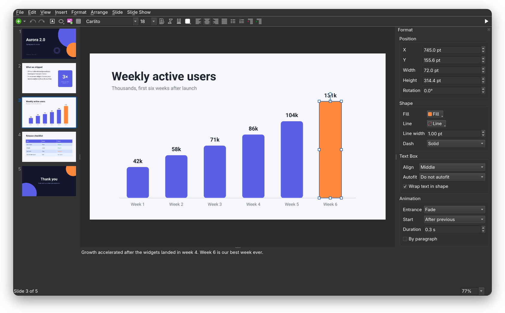
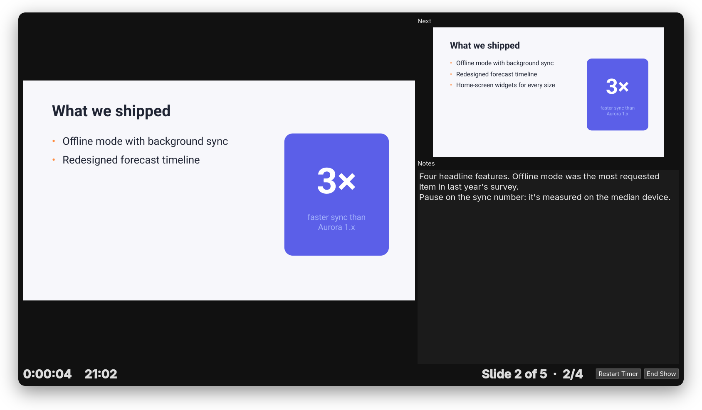

<p align="center">
  
</p>

<h1 align="center">Podium</h1>

<p align="center">
  <b>Make and present slides on Linux — in real PowerPoint files.</b><br>
  Open a <code>.pptx</code>, edit it, present it, send it back. Fast, native and free.
</p>

<p align="center">
  <a href="https://github.com/pedrocarv/podium/releases/latest"></a>
  
  <a href="LICENSE"></a>
</p>

<p align="center">
  
</p>

## Why Podium

- **Your files stay PowerPoint files.** No importing, converting or "save as" dance. Podium
  opens `.pptx` and saves `.pptx`, so the people you send it to just open it.
- **It doesn't break what it doesn't touch.** Charts, SmartArt, animations and effects that
  Podium can't edit yet are kept exactly as they were and saved back untouched.
- **It's fast.** A 37-slide, 300 MB deck full of images and video opens in a blink and saves in
  under a second.
- **It's built for presenting.** Presenter view with your notes, the next slide and a timer on
  your laptop while the projector shows the slides.
- **It's yours.** No account, no cloud, no internet connection, no subscription.

## What you can do

**Create**
- Write with any installed font, sizes, colors, bold, italic and underline, alignment,
  bullets, numbering and list levels
- Add 30+ shapes, lines and arrows, images (drag and drop or paste) and tables
- Line things up with snapping guides; group, layer, rotate and resize
- Start new slides from your template's layouts; set backgrounds; hide and reorder slides
- Keep speaker notes under every slide
- Undo everything

**Present**
- Full-screen slideshow with transitions (fade, push, wipe, cover)
- Builds: bullets appear one at a time, objects fade in on click or one after another
- Videos embedded in your slides play right in the show
- Presenter view on your own screen with notes, next slide, slide counter and timer
- Rehearse with presenter view on a single screen (`Alt+F5`)
- Black or white out the screen (`B` / `W`), jump to any slide by typing its number

**Share**
- Save as `.pptx` for PowerPoint, Google Slides, Keynote or LibreOffice
- Export to PDF with real, selectable text

<p align="center">
  
  
</p>

## Install

### AppImage (any distribution)

1. Download **`Podium-x86_64.AppImage`** from the
   [latest release](https://github.com/pedrocarv/podium/releases/latest).
2. Make it executable: `chmod +x Podium-x86_64.AppImage`
3. Double-click it, or run `./Podium-x86_64.AppImage`.

Works on 64-bit Ubuntu 22.04 and newer, Fedora, Debian 12, Arch and most other current
distributions. To add it to your app menu, use [Gear Lever](https://flathub.org/apps/it.mijorus.gearlever)
or AppImageLauncher.

### Build it yourself

On Arch (Omarchy, EndeavourOS, …):

```sh
sudo pacman -S --needed base-devel cmake ninja qt6-base qt6-svg qt6-multimedia libzip pugixml
git clone https://github.com/pedrocarv/podium && cd podium
cmake -B build -G Ninja -DCMAKE_BUILD_TYPE=Release
cmake --build build
cmake --install build --prefix ~/.local   # adds Podium to your app menu
```

Other distributions need the same pieces: Qt 6.5+ (base, SVG, Multimedia), libzip 1.10+,
pugixml and CMake.

## Try it

Open [`examples/demo.pptx`](examples/demo.pptx), press `F5` and click through: the bullets
build, the chart grows bar by bar, and the slides push and fade. Press `Alt+F5` to see the
presenter view.

## Keyboard shortcuts

| | |
|---|---|
| Start the show | `F5` from the beginning, `Shift+F5` from the current slide, `Alt+F5` presenter view |
| During the show | `→` `Space` or click: next · `←`: back · number + `Enter`: jump · `B`/`W`: black/white screen · `Esc`: end |
| New slide | `Ctrl+M` |
| Edit text | double-click or `Enter` · `Esc` when done · `Tab`/`Shift+Tab` change list level or move between table cells |
| Format | `Ctrl+B` `Ctrl+I` `Ctrl+U` · `Ctrl+]`/`Ctrl+[` bigger/smaller · `Ctrl+L` `Ctrl+E` `Ctrl+R` `Ctrl+J` align |
| Arrange | arrows nudge (`Shift` for bigger steps) · `Ctrl+D` duplicate · `Ctrl+G`/`Ctrl+Shift+G` group/ungroup |
| While dragging | `Shift` keeps the direction, proportions or 15° angles · `Alt` turns off snapping |
| Zoom | `Ctrl` + scroll · `Ctrl+0` fit the slide |

## Questions

**Will my presentation look the same in PowerPoint?**
Yes for everything Podium edits: it writes standard Office Open XML (checked against the
official ECMA-376 schemas). Text uses the fonts installed on your computer, so if a deck uses a
font you don't have (like Aptos or Calibri), Podium shows a similar one and line breaks can
differ slightly. Install the font to match exactly.

**Can it open old `.ppt` files or Keynote/Google Slides decks?**
Not directly. Save them as `.pptx` from PowerPoint, Keynote, Google Slides or LibreOffice first.

**What's not there yet?**
Editing slide masters and layouts, editing charts and SmartArt (they're kept intact), exit and
emphasis animations (kept in the file, not played), audio playback, and EMF/WMF images (kept
in the file, shown as placeholders).

**Is it free?**
Yes. Podium is open source under the [MIT license](LICENSE).

## From the command line

```sh
podium deck.pptx                          # open
podium --show --start 3 deck.pptx         # present from slide 3
podium --export-pdf deck.pdf deck.pptx    # export a PDF
podium --export-png slides/ deck.pptx     # export every slide as an image
```

## Contributing

Bug reports with a sample `.pptx` are the most helpful thing you can send. To work on the
code: `ctest --test-dir build` runs the test suite (file round trips, the editor driven by
simulated mouse and keyboard, the slideshow); the README's build steps above get you a dev
build. Podium is C++20 and Qt 6; `src/model.h` is a good place to start reading.

## License

[MIT](LICENSE) © 2026 Pedro Silva
